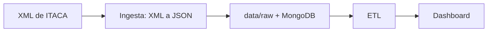
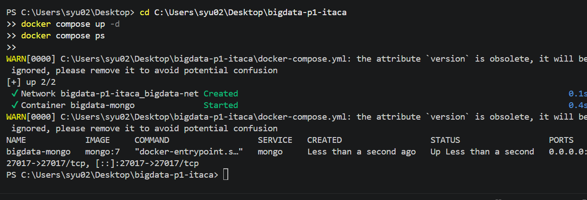

# Proyecto 1 · Práctica P1: Ingesta de datos de ITACA

## Descripción y objetivo

Pasar los XML de ITACA (alumnos, cursos, calificaciones y contenidos) a JSON en `data/raw/`, quedándonos solo con los campos necesarios y anonimizando el NIA.

## Arquitectura



## Estructura del repositorio

```
bigdata-p1-itaca/
├── data/
│   ├── exportaciones/     # XML originales
│   └── raw/               # JSON generados
├── ingesta/               # XML -> JSON
├── etl/
├── dashboard/
├── docs/
├── docker-compose.yml
├── .env.example
├── .gitignore
└── README.md
```

## Puesta en marcha

```bash
cp .env.example .env           # rellena las credenciales
docker compose up -d
python ingesta/ingesta_itaca_xml.py
```


